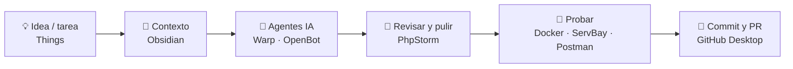

# 🖥️ Mi Setup de Desarrollo

**El hardware, las apps, las herramientas y los hábitos que uso a diario para crear apps web y con IA a máxima velocidad.**

[🇬🇧 English](README.md) · 🇪🇸 **Español**

---

> 👋 Soy **desarrollador backend / full-stack** con foco en **desarrollo web**, y también creo **aplicaciones con Inteligencia Artificial para multidispositivo**.
> Este repo es mi lista viva de todo lo que hay en (y alrededor de) mi mesa. Sin enlaces de afiliado: solo lo que uso de verdad y por qué.

## 📑 Contenido

- [💻 Hardware y escritorio](#-hardware-y-escritorio)
- [🧰 Apps y utilidades](#-apps-y-utilidades)
- [🔧 Herramientas de desarrollo](#-herramientas-de-desarrollo)
- [🤖 Asistentes de IA](#-asistentes-de-ia)
- [🧠 Hábitos y flujo de trabajo](#-hábitos-y-flujo-de-trabajo)

---

## 💻 Hardware y escritorio

### Equipo

| | Producto | Por qué me gusta |
|:-:|---|---|
| 💻 | [**MacBook Pro M5 Pro** · 24 GB](https://www.apple.com/es/macbook-pro/) | Rápido, silencioso y con mucha batería. Aguanta Docker, el IDE y varios agentes de IA a la vez. |

### Pantallas

| | Producto | Por qué me gusta |
|:-:|---|---|
| 🖥️ | [**Samsung CRG9** · 49" (C49RG90)](https://www.samsung.com/ie/monitors/gaming/odyssey-crg9-49-inch-120hz-freesync-curved-lc49rg90ssrxxu) | Super-ultrawide 32:9, 5120×1440 a 120 Hz. Como dos pantallas de 27" QHD sin marco en medio: IDE, navegador y terminal lado a lado. |
| 🖥️ | [**MSI G27CQ4** · 27"](https://us.msi.com/Monitor/Optix-G27CQ4) | Curvo WQHD (2560×1440), 165 Hz. Colocado **justo encima** del ultrawide para documentación, logs, chats y paneles. |

> 💡 **Consejo:** poner un segundo monitor *encima* del ultrawide mantiene todo en tu campo de visión sin girar la cabeza hacia los lados.

### Teclados y punteros

| | Producto | Por qué me gusta |
|:-:|---|---|
| ⌨️ | [**EPOMAKER × AJAZZ AK820 Pro** (ISO-ES)](https://epomaker.com/products/ajazz-ak820-pro) | Mecánico 75% con montaje gasket, hot-swap, Bluetooth / 2,4 GHz / USB-C, pantallita y rueda. Escribir en él es un gusto. |
| ⌨️ | [**Logitech Ergo K860**](https://www.logitech.com/es-es/products/keyboards/k860-split-ergonomic.920-009166.html) | Teclado ergonómico dividido y curvo con reposamuñecas. Lo **alterno** con el AK820 para variar la postura. |
| 🖱️ | [**Logitech Ergo M575**](https://www.logitech.com/es-es/products/mice/m575-ergo-wireless-trackball.910-005869.html) | Trackball de pulgar: el brazo quieto, el pulgar trabaja. Ideal para una pantalla de 49". |
| ✋ | [**Apple Magic Trackpad**](https://www.apple.com/es/shop/mac/accessories/mice-keyboards) | Gestos de macOS: cambiar de Espacio, Mission Control, scroll y zoom. |

### Ergonomía

| | Producto | Por qué me gusta |
|:-:|---|---|
| 🪑 | [**KERDOM KD9070**](https://www.amazon.es/s?k=KERDOM+KD9070) | Silla ergonómica ajustable en varios puntos: imprescindible para sesiones largas. |
| 🧍 | [**IKEA TROTTEN**](https://www.ikea.com/es/es/search/?q=trotten) | Mesa elevable **de manivela** (≈70–120 cm). Sí, es manual: así ponerse de pie es doble de ejercicio. 💪 |

---

## 🧰 Apps y utilidades

| | App | Para qué la uso |
|:-:|---|---|
| 🪟 | [**Mosaic**](https://lightpillar.com/mosaic.html) | Gestor de ventanas: diseños y atajos para dividir el ultrawide de 49" en zonas. |
| 🦁 | [**Brave**](https://brave.com) | Navegador principal, basado en Chromium y con bloqueador de anuncios y rastreadores. |
| 🕶️ | [**Chrome Headless**](https://developer.chrome.com/docs/chromium/headless) | Navegador sin interfaz que usan los agentes de IA para automatizar, extraer datos y probar. |
| 🔐 | [**Bitwarden**](https://bitwarden.com) | Gestor de contraseñas, sincronizado en todos mis dispositivos. |
| ✅ | [**Things**](https://culturedcode.com/things/) | Gestor de tareas: Hoy, Próximo, proyectos y áreas. |
| 🧠 | [**Obsidian**](https://obsidian.md) | Mi **segundo cerebro**: notas, documentación, ideas y decisiones, todo enlazado en Markdown. |

---

## 🔧 Herramientas de desarrollo

| | Herramienta | Para qué la uso |
|:-:|---|---|
| 🧩 | [**PhpStorm**](https://www.jetbrains.com/es-es/phpstorm/) | IDE principal: navegación, refactorización, depuración e inspecciones de PHP. |
| ⚡ | [**Warp**](https://www.warp.dev) | Terminal con IA integrada. Donde paso la mayor parte del tiempo trabajando el código con agentes. |
| 🤝 | [**OpenBot**](https://openbot.run) | App de escritorio para tener varios agentes de IA persistentes trabajando directamente sobre el código. |
| 🐳 | [**Docker Desktop**](https://www.docker.com/products/docker-desktop/) | Cuando no hay prisa: entornos locales lo más parecidos posible al servidor de producción. |
| 🚀 | [**ServBay**](https://www.servbay.com) | Cuando hay prisa: PHP, servidores web y bases de datos en local en minutos. |
| 📮 | [**Postman**](https://www.postman.com) | Diseñar, probar y documentar APIs. |
| 🐙 | [**GitHub Desktop**](https://desktop.github.com) | Git visual: revisar diffs, commits, ramas y pull requests. |

🐳 <b>¿Docker o ServBay? — cómo elijo</b>

 

| Situación | Elección | Motivo |
|---|---|---|
| Proyecto nuevo o bug que solo pasa en producción | 🐳 Docker | Mismas versiones y servicios que el servidor. |
| Prototipo rápido, arreglo pequeño, demo | 🚀 ServBay | Funcionando en minutos, sin montar contenedores. |

---

## 🤖 Asistentes de IA

No me caso con un solo modelo: cambio según la tarea, el coste y el tamaño del contexto.

| | Asistente | Proveedor |
|:-:|---|---|
| 🟠 | [**Claude / Claude Code**](https://claude.com/product/claude-code) | Anthropic |
| 🟢 | [**Codex**](https://openai.com/codex/) | OpenAI |
| 🔵 | [**Gemini CLI**](https://github.com/google-gemini/gemini-cli) | Google |
| ⚫ | [**OpenCode**](https://opencode.ai) | Agente de terminal open source |
| 🐋 | [**DeepSeek**](https://www.deepseek.com) | DeepSeek |
| 🌙 | [**Kimi**](https://www.kimi.com) | Moonshot AI |
| 🟣 | [**Qwen**](https://qwen.ai) | Alibaba |

---

## 🧠 Hábitos y flujo de trabajo

### 🎯 Bloques de foco
- Trabajo en **bloques largos sin interrupciones** con un modo Concentración de macOS: notificaciones fuera, una sola tarea.
- Elijo la tarea en **Things** *antes* de empezar el bloque, para no tener que decidir nada a mitad.

### 🧍 Pausas activas
- **Alterno sentado y de pie** con la mesa de manivela: girarla ya es una minipausa.
- **Cambio de teclado** (AK820 ↔ K860) y de puntero (trackball ↔ trackpad) para variar la postura.
- Descanso la vista a menudo: mirar lejos de la pantalla un momento.

### 🗂️ Segundo cerebro
- Todo va a **Obsidian**: ideas, decisiones técnicas, snippets, notas de reuniones.
- Enlazo notas entre sí en lugar de archivarlas en carpetas profundas.
- Si resuelvo algo dos veces, se convierte en nota.

### 🤖 Trabajar con agentes de IA

- **Dar contexto al agente**, no solo una orden: objetivo, restricciones y los archivos relevantes.
- **Revisar siempre** en el IDE lo que escribe la IA antes de hacer commit.
- **Usar el modelo adecuado para cada tarea** y comparar respuestas cuando una decisión importa.

---

⭐ Si algo de aquí te ha servido, ¡dale una estrella al repo!

Última actualización: noviembre de 2026

